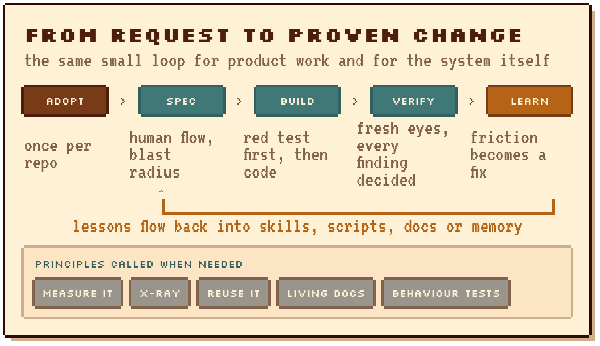
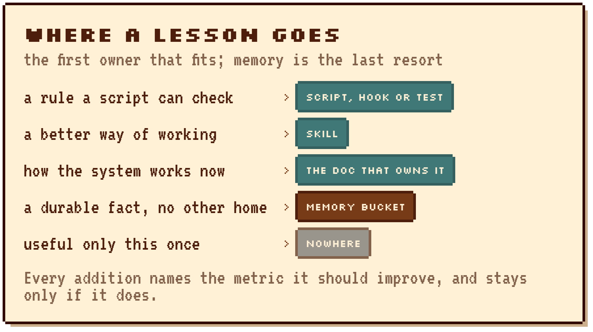
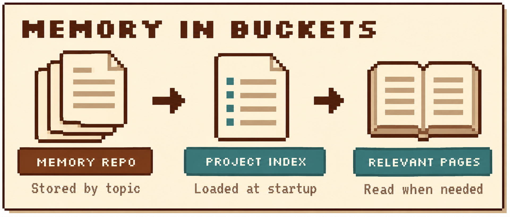

<p align="center">
  
</p>

<h1 align="center">Geppetto</h1>

<p align="center">
  <em>Make the skills you already use measurable — and let the agent improve them over time</em>
</p>

<p align="center">
  
  
  
  
</p>

[Matt Pocock's skills](https://github.com/mattpocock/skills) and [pstack](https://github.com/backnotprop/pstack) already tell an agent how to work, and they are worth keeping, but a pack of procedures still leaves two questions open: which of those procedures actually help on your work, and how the agent gets better after a bad turn without you rewriting the skills by hand.

A skill can sit installed and never be called, and the same friction can show up twice and die with the chat, because nothing in the harness records it as a lesson. Google Research's [Harness²](https://github.com/google-research/harness2) will rewrite the harness around the model so that kind of improvement can happen, which also means leaving Claude Code or Codex and the skills you already trust.

Geppetto stays in that harness instead of replacing those packs. It adds the missing conditions for learning — a record of what happened, a measurement before a rule or skill edit is kept, and work small enough that a lesson has somewhere to attach — so recurring friction can go back into a script, a skill, the docs, or memory. Adopt, specify, build, and verify exist for that reason, not as a second methodology: your test framework, tracker, and other skill packs stay yours.

<p align="center">
  
</p>

## Install

**Claude Code**

```bash
/plugin marketplace add immagiov4/geppetto
/plugin install geppetto@geppetto
```

**Codex**

```bash
codex plugin marketplace add immagiov4/geppetto
codex plugin add geppetto@geppetto
```

**Any agent that reads `.agents/skills`** (OpenCode, Pi and others; untested)

```bash
git clone https://github.com/immagiov4/geppetto
node geppetto/skills/geppetto-adopt/scripts/install.mjs --target agents --project <your-repo> --dry-run
```

Review the dry-run, then rerun without `--dry-run`. In the project, ask:

```
Install Geppetto on this project.
```

`geppetto-adopt` inspects the project and machine, asks once, installs hooks and learning, connects maintenance jobs through an available scheduler and finishes with an installed/reused/skipped recap. An existing OpenRouter key enables skill and memory suggestions; when missing, the installer makes one optional offer. Reruns reconcile existing resources across projects. Architecture: [system map](docs/system-map.md). Contributor commands: [development](docs/development.md).

## Limits

- **Two harnesses tested.** Claude Code and Codex. Pi and OpenCode can load the skills; nobody has trialled them there yet.
- **Harness loading and hook trust.** Installation checks files and native hook hashes; verify actual hook and skill loading in a fresh session. Codex project layers also require project trust.
- **Paid API limits.** API accounting covers requests made through Geppetto. Put a hard spending limit on the OpenRouter key; a local maximum cannot bound a provider call whose final charge is unknown.
- **Maintenance scheduling.** Periodic jobs need an available harness or OS scheduler; the recap names missing prerequisites. Subscription learning uses the installed CLI account and its available tools.
- **First CI run** on the PR that introduces Geppetto needs an owner-pinned Geppetto commit. [CI bootstrap](skills/geppetto-adopt/assets/templates/ci/README.md).

<details>
<summary>How a lesson is kept</summary>

Some of the principle skills look familiar, such as behaviour tests, living docs, and measure-before-keep, because the learning loop has nothing to stand on without a minimum of visibility and measurement. They are not there to replace your methodology: other packs install alongside, adoption records the tools you already have, and how you write a specific test stays yours.

<p align="center">
  
</p>

When the same friction keeps returning, a signal can be recorded, and `geppetto-learn` separates what was observed from a guess at the cause before it puts the fix in the first place that can hold it: an enforceable check, a procedure, the documentation that already owns the fact, or memory. A process change is measured before it is kept, so a guess does not become a rule on its own.

<p align="center">
  
</p>

Facts that outlive a chat live in a private Git repository of Markdown, grouped into buckets, and at session start the hook supplies the indexes of the buckets you linked, with no API key required for that path. An optional classifier suggests pages per request when its OpenRouter key is present. [Memory retrieval](docs/memory-retrieval.md).

</details>

<details>
<summary>Skill and script inventory</summary>

| | |
|---|---|
| **Procedures** | `geppetto-adopt`, `geppetto-spec`, `geppetto-build`, `geppetto-verify`, `geppetto-learn`, `geppetto-memory`, `geppetto-authorize` |
| **Principles** | `geppetto-measure-it`, `geppetto-x-ray`, `geppetto-reuse-it`, `geppetto-living-docs`, `geppetto-behaviour-tests` |
| **Bundled** | `writing-for-agents`, `requirements-blast-radius`, `skill-learning-patterns`, `code-review`, `receive-work-feedback`, `retro` (optional) |
| **Scripts** | `audit`, `install`, `gate-sections`, `gate-agents`, `authz`, `signal`, `memory-hook`, `learn-nudge`, `learn-runner`, `machine`, `migrate-agents`, `host-lint` |

Bundled copies keep provenance in [THIRD_PARTY_NOTICES.md](THIRD_PARTY_NOTICES.md).

</details>

## License

MIT. Bundled skills keep their own MIT notices; see [THIRD_PARTY_NOTICES.md](THIRD_PARTY_NOTICES.md).

Influenced by [Matt Pocock's skills](https://github.com/mattpocock/skills), [pstack](https://github.com/backnotprop/pstack), and [OpenRig](https://github.com/mvschwarz/openrig).
